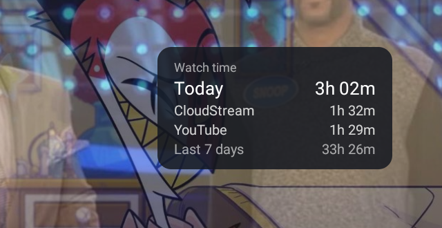
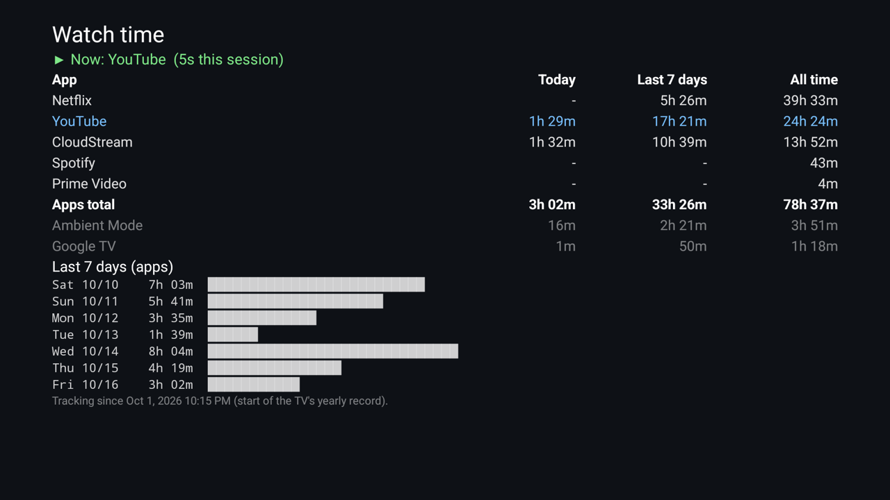

# tv-stats

Watch-time stats for an Android TV / Google TV, read from the TV's own usage log over adb. One Python
file, no dependencies, nothing installed on the TV.

```
▶ Now: CloudStream  (4m this session)

App                 Today  Last 7 days   All time  Launches
Netflix                 -       5h 26m    39h 33m        35
YouTube            1h 21m      17h 13m    24h 16m        63
CloudStream        1h 30m      10h 37m    13h 52m        34
Apps total         2h 51m      33h 16m    78h 28m

Screensaver           16m       2h 21m     3h 51m        27
Google TV Home        53s          49m     1h 17m        86

Last 7 days (apps)
  Sat Oct 10  ██████████████████████████     7h 03m
  ...
Tracking since 10/1/2026, 10:15 PM (start of the TV's yearly record).
```

## Setup

1. On the TV: Settings → System → About → press OK on **Android TV OS build** 7 times to enable
   Developer options. Then Settings → System → Developer options → turn on **USB debugging**
   (on some TVs also **Network debugging**).
2. On your computer, install adb (`brew install android-platform-tools` on macOS) and Python 3.9+.
3. Run it with your TV's IP address (Settings → Network & Internet → your network):

```sh
TV_HOST=192.168.1.20 ./tvstats.py          # live view, refreshes every 5 s (Ctrl-C to quit)
TV_HOST=192.168.1.20 ./tvstats.py report   # print once
```

The first time, the TV asks "Allow USB debugging?". Tick **Always allow from this computer**.

## On the TV itself (Android app)

`android/` is a small app that runs on the TV, with no computer needed after setup:

| Home panel | Dashboard |
|---|---|
|  |  |

- **Home panel:** a small card under the clock on the Home screen with today's total, today's top 3
  apps and the last 7 days. It can't be selected with the remote and hides as soon as an app opens.
- **Dashboard:** open **Watch time** from your apps for the full table and the 7-day chart.

Build with the Android SDK command-line tools (platform 34, build-tools 34.0.0) and JDK 17, then
install and grant its permissions once:

```sh
android/build.sh
adb install -r android/build/tvstats.apk
adb shell appops set dev.tvstats GET_USAGE_STATS allow
adb shell appops set dev.tvstats SYSTEM_ALERT_WINDOW allow
adb shell appops set dev.tvstats APP_AUTO_START allow   # TCL TVs only: lets it start at boot
```

Then open **Watch time** once from your apps. After that, the panel starts by itself at every boot.

## How it counts

- **Today / Last 7 days:** from the app open and close events (`dumpsys usagestats file`). An app is
  in front from its first resumed screen until the screen in front pauses, which is how Android counts
  `totalTimeUsed`. Days split at local midnight in the TV's timezone. The TV keeps these events for
  about 10 days.
- **All time:** the TV's yearly usage bucket, which starts when the TV was set up (or at its last
  yearly rollover). The current session is added live, since Android only adds it when the app closes.
- Home screen, screensaver, Settings and similar are listed separately and left out of **Apps total**.
- Unknown apps show their package name's last part. Add a friendly name to `LABELS` in `tvstats.py`.

Tested on a TCL Google TV (Android 12). Other Android TV devices use the same `usagestats` service,
but the output format can vary between Android versions.

## License

MIT
